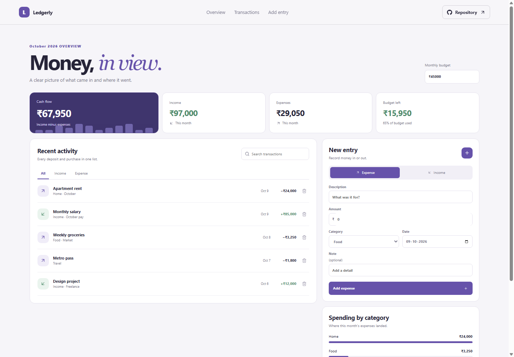

# Ledgerly Expense Tracker

Ledgerly records day-to-day income and expenses, summarizes this month's cash flow, and keeps spending against a simple budget in view.

## What it includes

- Monthly cash flow, income, expenses, and remaining-budget summaries.
- A transaction list with search and All, Income, and Expense filters.
- An entry form for income or expenses with category, date, and optional note.
- Spending totals for the largest expense categories.
- A custom confirmation dialog before deleting a transaction.
- Indian rupee formatting and a responsive layout.

## How to use it

Choose Income or Expense in New entry, then enter a description, amount, category, and date. Income entries use the Income category automatically. The summary cards update when an entry is added or deleted. Change Monthly budget to compare this month's spending against a different limit. Use the filters or search field to find an entry.

## Saving and data

Transactions and the monthly budget are saved in this browser's local storage. They remain available on this device and browser after a reload, but are not synced to another device or account. The starter entries are sample data and can be deleted.

## Run locally

Run npm install to install dependencies, npm run dev to start the local server, npm run lint and npm run build to check the project, and npm run deploy to publish it to GitHub Pages.

Planned URL after deployment: https://a2rp.github.io/expense-tracker/

## Future improvements

Ideas that are not implemented yet: CSV import and export, recurring transaction rules, and optional monthly category limits.

## Links

- Portfolio: [https://www.ashishranjan.net](https://www.ashishranjan.net)
- GitHub: [https://github.com/a2rp](https://github.com/a2rp)
- CodePen: [https://codepen.io/ash1198](https://codepen.io/ash1198)
- LinkedIn: [https://www.linkedin.com/in/aashishranjan](https://www.linkedin.com/in/aashishranjan)
- Facebook: [https://www.facebook.com/theash.ashish/](https://www.facebook.com/theash.ashish/)
- YouTube: [https://www.youtube.com/@ashishranjan-ashz?sub_confirmation=1](https://www.youtube.com/@ashishranjan-ashz?sub_confirmation=1)
- Email: [mailto:ash.ranjan09@gmail.com](mailto:ash.ranjan09@gmail.com)

## Support

- Support: [https://a2rp-donation-page.netlify.app/](https://a2rp-donation-page.netlify.app/)
- Buy Me a Coffee: [https://buymeacoffee.com/ashishranjan](https://buymeacoffee.com/ashishranjan)
- Patreon: [https://www.patreon.com/ashishranjan](https://www.patreon.com/ashishranjan)